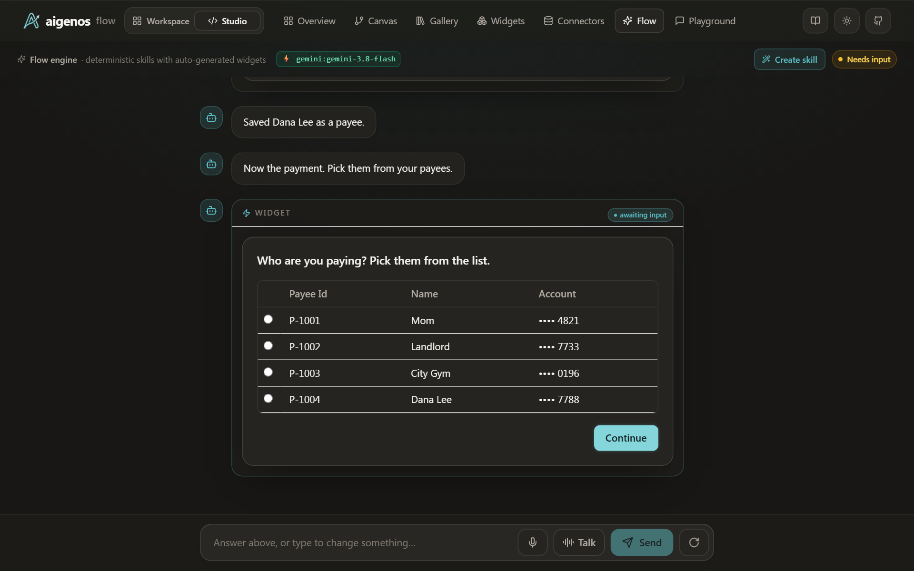
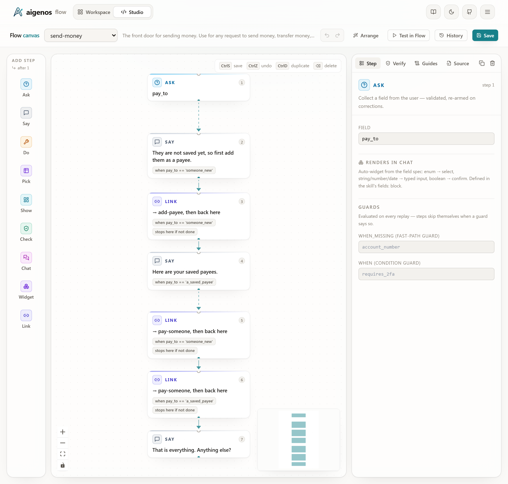

# send-money — one errand, three flows

How to build something bigger than one flow: a flow that branches on an
answer and hands the user to other flows, each with its own questions, checks
and gates.

The errand is the one every banking app has. *Send money*: to someone new, or
to a payee you have already saved? If they are new, add them first. Then pay.

```
                    ┌──────────────────────────────┐
  "I need to send   │ send-money        (the router)│
   some money"  ──▶ │  ask: someone new, or saved?  │
                    └──────┬────────────────┬───────┘
               someone new │                │ a saved payee
                           ▼                │
                 ┌───────────────────┐      │
                 │ add-payee         │      │
                 │  name, routing,   │      │
                 │  account          │      │
                 │  gate: routing    │      │
                 │        checksum   │      │
                 │  gate: confirm    │      │
                 │  write: save payee│      │
                 └─────────┬─────────┘      │
                           ▼                ▼
                 ┌──────────────────────────────────┐
                 │ pay-someone                      │
                 │  pick a payee from the list      │
                 │  amount                          │
                 │  gate: known payee               │
                 │  gate: within balance            │
                 │  branch: $1,000 or more → code   │
                 │  gate: confirm                   │
                 │  write: send payment             │
                 └────────────────┬─────────────────┘
                                  ▼
                    back in send-money: "Anything else?"
```

| | |
|---|---|
| The router | [`send-money/SKILL.md`](../../skills/send-money/SKILL.md) — one question and two branches in a skill file, no Python |
| Flow 1 | [`add-payee/SKILL.md`](../../skills/add-payee/SKILL.md) |
| Flow 2 | [`pay-someone/SKILL.md`](../../skills/pay-someone/SKILL.md) |
| The bank they share | [`tools/bank.py`](../../skills/tools/bank.py), the folder every skill's tools live in — in memory; no account exists and no money moves |
| The proof (no key, no network) | [`prove.py`](prove.py) — 47 checks |

The three skill folders sit in [`examples/studio_agent/skills`](../../skills)
with the rest of the agent the Studio opens, so they show up there with no
setup.



*The second flow has just started. Its list already shows Dana Lee, whom the
first flow saved one step earlier. A live model is running; it chose nothing
on this screen.*

## Run it

No API key, about a second:

```bash
python examples/studio_agent/proofs/send_money/prove.py
```

With a model, in the Studio ([how to start it](../../../../README.md#the-studio)):
the three skills are already in its list (`send-money`, `add-payee`,
`pay-someone`).

Open **Flow** and type *"I need to send some money"*. It asks one question,
with two answers:

- **Someone New**: it says they are not saved yet and starts `add-payee` (a
  routing number that works: `021000021`; change one digit and it is refused).
  Once the payee is saved it says the payment is next and shows your payees,
  the new one included. For $1,000 or more the demo's code is `481920`.
- **A Saved Payee**: it says *"Here are your saved payees"* and goes straight
  to that list. `add-payee` never runs.

Say no at *"Save this payee?"* and the errand stops there: nothing is saved and
it does not go on to ask who you are paying.

Things to say part-way, at any step:

- *"never mind"*, then *"who was I paying?"*: it is cancelled, nothing was
  sent, and it still knows who you had picked.
- *"continue where I left off"*: back at the question you stopped on, with
  what you had entered. A code or a yes is asked for again.
- *"start over"*: the first question again, in one message.
- *"send it to someone else"*: the list of payees again; the amount is kept.

## The whole router

```yaml
steps:
  - ask: { pay_to: "Is this payment to someone new, or to a payee you have already saved?" }
    choices: [someone_new, a_saved_payee]
  - when: pay_to == 'someone_new'
    steps:
      - say: They are not saved yet, so first add them as a payee.
      - do: add-payee
        else: No payee was added.
      - say: Now the payment. Pick them from your payees.
      - do: pay-someone
        else: No payment was made. The payee you added is still saved.
  - when: pay_to == 'a_saved_payee'
    steps:
      - say: Here are your saved payees.
      - do: pay-someone
        else: No payment was made.
  - say: That is everything. Anything else?
```

That is the branch (a `when:` with its own steps), the chain (one `do:` after
another), and what happens when a flow is cancelled or declined (`else:`, and
the flow stops). No prompt describes this order, so no model can change it, and
there is no Python in it: the router is one skill file. None of the three
skills has Python of its own; the bank's functions are in one shared file.

Two details are there because the first version got them wrong:

- **The question is a choice, not a yes/no.** It used to read *"Is this someone
  you have not paid before?"*, where "No" meant "go on and pay". Each answer
  now names where it leads.
- **Each branch says which way it went.** Both branches end at the same payee
  list, so with no line in between, choosing the other answer looked as if it
  had been ignored.

On the Studio's Canvas the same file is a column of steps you can edit:



`do: other-skill` is a call, not a jump:

- The target starts with **its own empty answers and its own confirmations**.
  The router cannot see them and cannot skip them.
- When the target finishes, the router carries on **from the next step**. A
  hand-off that has run is not taken again, however many turns follow.
- If the target did its job the router goes on. If the user cancelled it or
  said no at its confirmation, the router says `else:` and **stops**. Nothing
  else comes back. That is why declining *"Save this payee?"* ends the errand
  instead of leading on to a payment.
- A Python flow has the same hand-off as `ctx.link("other-skill")`, which
  returns `True` or `False`, for the rare router that should carry on after a
  no.

## Three ways to branch, all in this example

| Kind | Where | How |
|---|---|---|
| **Between flows**: one answer goes through a flow, the other skips it | `send-money` | a `when:` block with a `do: add-payee` in it |
| **One flow after another** | `send-money` | two `do:` steps, one after the other |
| **Inside a flow**: a question that exists only on one branch | `pay-someone` | `when: quote_payment.needs_code` on the code question |

All three are lines in a skill file and all three show on the Studio's Canvas. Use the last one
whenever the branches belong to one job. Reach for separate flows when a piece is worth
running on its own. Here both pieces are: *"add a payee"* and *"pay my
landlord"* each start their flow directly, with no router involved.

## How the flows share anything

They don't, through the conversation. `add-payee` saves the payee in the bank;
`pay-someone` lists payees from the bank, and the new one is there. That is the
design to copy: flows meet in your system of record, the way two screens of an
app do. It is also why a flow that runs on its own behaves exactly as it does
inside the errand.

## What the proof checks

`prove.py` scripts the model (`TestHost`) and drives these conversations:

1. **Someone new.** The router says which way it went, then every refusal on
   the way: a routing number with one wrong digit, $2,600 against a $2,500
   balance, a model that supplies the code and the "yes" itself, a wrong code.
   Then the payment, confirmed twice and sent once. At each step it checks
   which flow is in charge and which is waiting underneath.
2. **A saved payee.** The router says so and goes to the list: `add-payee`
   never starts, and for $50 the code steps never run.
3. **Separation.** `add-payee` starts with no fields. Cancelling inside it
   returns to the router, which ends the errand: nothing saved, nothing sent,
   and `pay-someone` never starts. And a real conversation that used to go
   wrong: part-way through adding "John", the user types *"lets send to
   vivek"* and the model reads it as "start send-money". The errand does not
   end: the name becomes Vivek and the same question is asked again.
4. **Saying no.** No at *"Save this payee?"*: nothing is saved, the router says
   so and ends, and `pay-someone` never starts. No at *"Send this payment?"*:
   nothing is sent, and the router reports that instead of "that is
   everything". If a payee was added on the way, it says the payee is still
   saved.
5. **Five more runs** of the first conversation: the same route through the
   flows, the same bank calls, the same two writes.

## Limits

- **No values pass between flows**, in or out, other than whether the target
  did its job. Share state through your own backend, as here. That is also why
  you pick the new payee from the list instead of having them pre-selected.
- **"Said no" is detected for flows written in a skill file**, which is what
  `add-payee` and `pay-someone` are: a no at a confirmation, with none of the flow's writes
  fired. A Python flow that is declined still reports that it ran to its end.
- **A hand-off returns to its caller.** There is no "go there and do not come
  back"; end the router after the `do:` if that is what you want.
- **The first answer cannot be changed from inside a flow.** If you pick
  *Someone New* by mistake and then type "actually they are already saved",
  the model treats it as a side trip into `pay-someone`, and when that ends
  you are back in `add-payee`. Say cancel and start again.
- **A typed answer to the first question has to use the option's words.**
  The choice is a user-only field, so the runtime takes *"someone new"* or *"a
  saved payee"* and answers anything else with the two options. The dropdown
  always works.
- **The model still routes the first message.** *"I need to send some money"*
  reaches `send-money` because a classifier read the skills' descriptions, and
  the descriptions matter: with a vaguer wording, one try in four went straight
  to `pay-someone`. With the wording shipped here, 60 of 60 tries across two
  Gemini models and six phrasings reached the intended skill, with twelve
  skills loaded. That is a measurement, not a guarantee; everything after that
  first step is program text.
- **The three skills travel with their tools.** All three name functions in
  `skills/tools/bank.py`; copy that file with them.
- The bank is a toy. The routing-number checksum and district prefixes are the
  real rules; the accounts, the balance and the code are not.
